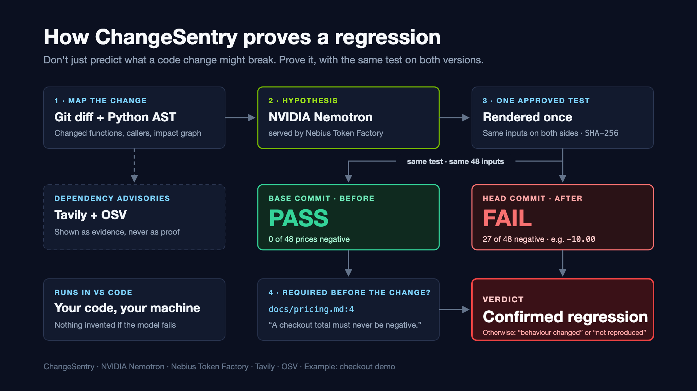
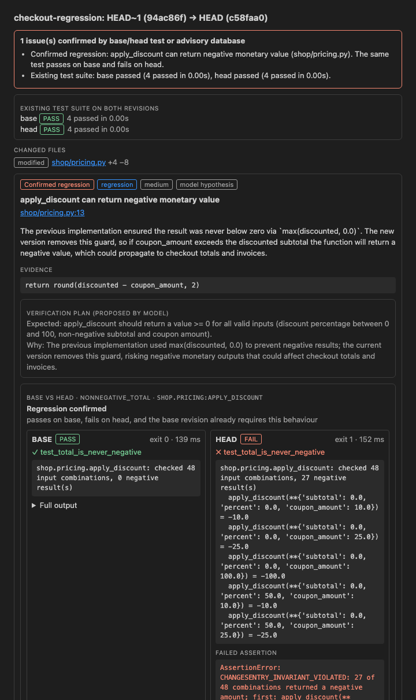
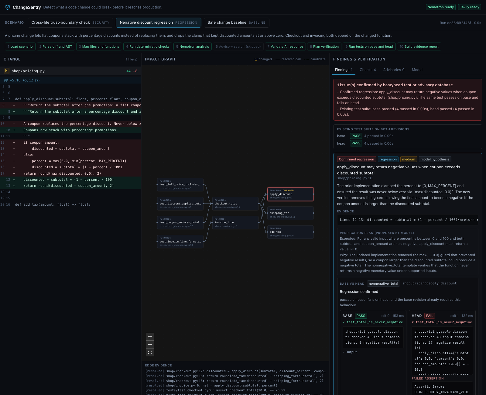

# ChangeSentry

**Don't just predict what a code change might break. Prove it before it reaches production.**

Built with **NVIDIA Nemotron** · served by **Nebius Token Factory** · advisories from **Tavily** and **OSV** · runs in **VS Code**



## Try it in 5 minutes

1. **Download** [`ChangeSentry-test-kit.zip`](https://github.com/ayesha-noor12/CHANGESENTRY/releases/latest) from the latest release. It holds the VS Code extension, three demo repositories and a guide.
2. **Install** `changesentry-0.1.0.vsix` in VS Code (**Extensions → … → Install from VSIX…**), then run **ChangeSentry: Enter API keys** with your [Nebius Token Factory](https://tokenfactory.nebius.com) key.
3. **Open `demos/checkout`**, click **🛡 ChangeSentry** in the status bar, and choose **Last commit**, then **Previous commit**. Expected: base **PASS**, head **FAIL** (27 of 48 prices negative), **confirmed regression**.

Full guide with the expected result for every demo: [docs/TESTING.md](docs/TESTING.md). Requires Python 3.10+, git and VS Code 1.90+.

---

## The problem, in one example

A developer lets discount coupons stack with percentage promotions. The new feature works, and **every existing test still passes**, so the change gets merged. But the change also deleted the line that kept a price from going below zero. A $0 item with a $10 coupon now costs **−$10**.

An AI reviewer might say "this *could* produce negative prices". That's a guess, and developers learn to ignore guesses.

**ChangeSentry proves it.** It runs the *same* test, with the *same* 48 inputs, on the code before and after the change:

| | Before the change (base) | After the change (head) |
|---|---|---|
| Test result | ✅ **PASS**: 0 of 48 prices negative | ❌ **FAIL**: 27 of 48 negative, e.g. `-10.0` |

It then checks that "never negative" was a real rule *before* the change, and finds it in the project's own `docs/pricing.md`. Passes before, fails after, breaks a documented rule: **a confirmed regression, not an AI opinion.**

## What makes it different

ChangeSentry reports a **confirmed regression** only when both of these hold:

1. The identical test **passes on the base revision and fails on the head revision**.
2. The **base revision itself** states or enforces the tested behaviour. This is found by deterministic rules, never by the model.

Everything else is labelled for what it is: *behaviour changed*, *fails on both*, *not reproduced*, *inconclusive* or *not tested*. Every report also lists the checks that were **not** performed.

<p align="center"></p>

*The report in VS Code: the identical test passes on the base commit and fails on the head commit, with the counterexamples and the failed assertion.*

---

## How we use NVIDIA Nemotron and Nebius Token Factory

Nemotron is the investigator. It decides **what is worth testing**, and ChangeSentry turns that decision into executable proof.

| Role | What Nemotron does | Where |
|---|---|---|
| **1. Hypothesis** | Reads the git diff, the impact-graph edges, source excerpts of every connected function, the `ruff`/`bandit` output, the existing test results and the list of valid test targets. It returns structured risks: what might break, why, and with which evidence | [`prompts.py`](backend/app/prompts.py) `ANALYSIS_TEMPLATE` |
| **2. Verification plan** | For each risk (up to 3, in parallel), picks the test template and target, and states the expected behaviour | [`prompts.py`](backend/app/prompts.py) `PLAN_TEMPLATE`, [`pipeline.py`](backend/app/pipeline.py) |

**It makes a measurable difference.** In the checkout scenario, no deterministic rule spots the bug. Without Nemotron, ChangeSentry honestly reports *"No issue detected; model analysis did not complete"*. With Nemotron, it proposes the non-negative check on `apply_discount`, and the base/head test **confirms the regression**.

**The model is used safely:**
- **Structured output only:** responses must be JSON, validated with Pydantic, with one bounded retry if invalid.
- **Grounded:** the backend rejects any risk that cites an unknown file, a line outside the file, or a test target that doesn't exist in the AST index, and shows the rejections in the report.
- **No code from the model is ever executed.** Nemotron only picks a template id and a target from an approved list. The backend fills the template itself.
- **Honest failure:** if a call fails, the report says *"model analysis did not complete"*. Nothing is invented to fill the gap.

**Served through Nebius Token Factory** ([`nemotron_client.py`](backend/app/nemotron_client.py)):
- Uses Token Factory's OpenAI-compatible endpoint, with `nvidia/nemotron-3-super-120b-a12b` at temperature 0.1 for repeatable analysis.
- The model id is configurable. `python -m scripts.check_nebius` lists the Nemotron models your key can use.
- The VS Code extension checks your key against Token Factory's `/models` endpoint before every run. A rejected key is caught up front, not halfway through an analysis.

## How we use Tavily (and OSV)

When a change adds or re-pins a dependency ([`advisory_search.py`](backend/app/advisory_search.py)), two sources are queried, and the report keeps their strength of evidence separate:

| Source | Query | Treated as |
|---|---|---|
| **OSV** | An exact package and version lookup | **Verified**: "this version is listed as affected" |
| **Tavily** | `"<package>" "<version>" security advisory CVE affected versions`, restricted to advisory domains (osv.dev, nvd.nist.gov, github.com, security.snyk.io, pypi.org), top 5 results | **Leads**: titles, links and snippets for a human to read, never proof |

In the `auth-boundary` scenario, the change adds `PyJWT==1.7.1`. OSV lists that exact version as affected (GHSA-2gx3-rcp4-g85q and others). Tavily returns related PyJWT advisory pages from GitHub and OSV, which is useful reading but not all specific to 1.7.1. That is why they are shown as leads. Tavily rate limits and rejected keys are reported in the report, not hidden.

---

## Measured results

From `python -m scripts.run_eval` with the real Nemotron model on 29 October 2026, and repeated through the VS Code extension on real git repositories.

| Scenario | Base | Head | Conclusion | Requirement found in the base revision |
|---|---|---|---|---|
| **checkout-regression** | PASS: 48 inputs, 0 negative | FAIL: the same 48 inputs, 27 negative | ✅ **Regression confirmed** | `docs/pricing.md:4`: "A checkout total must never be negative." |
| **auth-boundary** | PASS: the route returns 404 (it didn't exist yet) | FAIL: anonymous callers get HTTP 200 and a refund is issued | ✅ **Regression confirmed**, with the caveat [below](#limits) | `app/routes/admin.py:9`: the existing refund route calls `require_admin` first |
| **safe-change** | Existing suite PASS (4 tests) | Existing suite PASS (4 tests) | ✅ **No regression detected**, no findings invented | Not applicable |

In every scenario the project's existing tests pass on both revisions. ChangeSentry's targeted test is what catches the problem.

## How it works

1. **Map the change.** Git diff plus Python `ast`: changed functions, their callers and callees up to 3 hops, and route decorators. Edges are marked *resolved* (through a static import) or *candidate* (matched by name only).
2. **Deterministic checks.** `ruff` and `bandit` run on the changed files, and the project's own test suite runs on **both** revisions. A guard-consistency rule flags a new route that calls an operation every other route protects.
3. **Hypothesis and plan:** Nemotron, as described above.
4. **One test, two revisions.** The approved template is rendered **once**, with its inputs written in as literals. The identical file (SHA-256 shown) runs in disposable copies of base and head, with a timeout, a CPU limit, a memory limit where the OS allows it, and an environment stripped of API keys.
5. **Classify:**

   | Base | Head | Result |
   |---|---|---|
   | PASS | FAIL | **Confirmed regression** if base has the requirement, otherwise *behaviour changed* (may be intended) |
   | FAIL | FAIL | *Fails on both*: a pre-existing issue or an invalid test |
   | FAIL | PASS | *Fixed on head*: a possible improvement |
   | PASS | PASS | *Not reproduced* |
   | error | | *Inconclusive* |

6. **Find the requirement in base** ([`expectations.py`](backend/app/expectations.py)): a written rule ("never negative") in docs, the README or the related modules, or an existing route that guards the same operation.
7. **Report:** the verdict, base and head output side by side, the failed assertion, requirement citations as `file:line`, caveats, the test code and its hash, and the checks not performed.

---

## Try it

### VS Code extension (recommended)

```bash
cd vscode-extension && npm install && npm run package    # builds changesentry-0.1.0.vsix
code --install-extension changesentry-0.1.0.vsix
cd ../backend && python -m scripts.make_demo_repo checkout-regression ~/changesentry-demo
```

1. Open `~/changesentry-demo` in VS Code.
2. Run **ChangeSentry: Enter API keys**. It asks for the Nebius key, checks it with Nebius before saving, then asks for an optional Tavily key. Keys live in VS Code's encrypted secret storage. **ChangeSentry: Import API keys from .env file** works too.
3. Click **🛡 ChangeSentry** in the status bar and choose **Last commit**, then **Previous commit**.

The report opens beside your code, and the involved line gets a red underline and a **Problems** entry. The first run offers to install the Python backend into a private environment (Python 3.10+ required). You can also check **uncommitted changes** against your last commit, before you push.

The same thing from the command line: `python -m app.cli --repo ~/changesentry-demo --base HEAD~1 --head HEAD`.

### Web dashboard

The same analysis is also available as a web dashboard, with the diff, an interactive impact graph and the findings side by side.



```bash
# Backend
cd backend
python3 -m venv venv && source venv/bin/activate
pip install -r requirements.txt
cp .env.example .env            # NEBIUS_API_KEY, NEBIUS_MODEL, TAVILY_API_KEY
python -m scripts.check_nebius  # lists your Nemotron models and sends a test call
uvicorn app.main:app --reload --port 8000

# Frontend (second terminal)
cd frontend && npm install && npm run dev   # http://localhost:3000
```

Keys are read only by the backend. Next.js proxies `/api/*` to FastAPI, so no secret ever reaches the browser.

### Reproduce the measured results

```bash
cd backend
pytest                      # 11 offline tests: the model and network are stubbed
python -m scripts.run_eval  # all three scenarios end to end with your keys
```
```
PASS checkout-regression: model=ok verdict=issues_confirmed risks=1 confirmed=['nonnegative_total']
     existing tests: base=passed (4 passed) head=passed (4 passed)
     nonnegative_total shop.pricing:apply_discount: base=passed head=violated -> regression_confirmed (3 base requirement(s), test sha256 8483e9fa0e8e)
```

---

## Project structure

```
backend/
  app/pipeline.py           orchestration: diff → checks → Nemotron → validate → plan → base/head test → report
  app/nemotron_client.py    Nebius Token Factory client (JSON-validated, one retry)
  app/prompts.py            Nemotron prompts: analysis and verification plan
  app/test_runner.py        renders the test once, runs it on base and head, classifies
  app/expectations.py       finds the requirement in the base revision
  app/advisory_search.py    OSV + Tavily dependency advisories
  app/git_source.py, cli.py analyze two revisions of a local git repository
  scenarios/                three demo projects (before/ and after/)
vscode-extension/           the VS Code extension (TypeScript)
frontend/                   the web dashboard (Next.js + React Flow)
docs/images/                the images in this README
```

## API (web dashboard backend)

| Method | Path | Notes |
|---|---|---|
| `GET` | `/api/health` | Which integrations are configured (booleans and the model id, never keys) |
| `GET` | `/api/scenarios` | The bundled scenarios |
| `POST` | `/api/analyze` | `{"scenario_id": "checkout-regression"}`. Add `"wait": true` to block until done |
| `GET` | `/api/analysis/{run_id}` | Stage progress and the report |

The report schema is in [`backend/app/models.py`](backend/app/models.py).

## Limits

We'd rather state these than have you find them:

- **The authorization baseline is weaker than the checkout one.** The new webhook route doesn't exist on the base revision, so base returns **404** and the test passes because the endpoint wasn't there. That shows anonymous callers couldn't trigger a refund through this path before; it does **not** show that a guard was removed from an existing route. The requirement comes from a *different* base route that guards the same refund operation, and the report shows this caveat next to the result.
- **Model failures make the analysis incomplete, not invented.** In our runs, one Nemotron call out of about a dozen failed and we could not reproduce it. When that happens the report says so, and rerunning normally succeeds.
- **Two verification templates today:** monetary non-negativity and route authorization. Risks outside them are shown as *Not tested*. Broader Nemotron-generated tests are the next step.
- **Python and pytest only.** The call graph is static, so dynamic dispatch and framework wiring can hide relationships.
- **Running a check executes the project's code,** as `pytest` would. That is why ChangeSentry runs locally in VS Code on your own code, and there is no hosted "paste any GitHub URL" mode. On a shared server, running strangers' code would expose the API keys and the machine.
- Passing checks are evidence, not proof that a change is safe.

## License

MIT. See [LICENSE](LICENSE).
